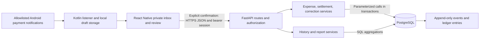
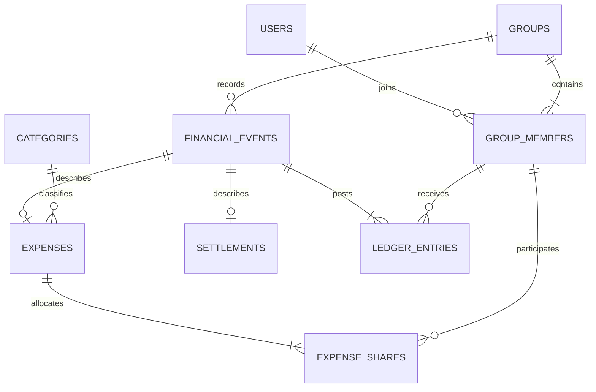

# Splix — Mobile System Architecture

## System boundaries

Use a modular monolith: an Android-first React Native app with a Kotlin capture module, one FastAPI API, and PostgreSQL. The API authenticates users and coordinates workflows; PostgreSQL enforces financial integrity. Payments occur outside Splix. Notifications are untrusted suggestions, not payment verification.

Status as of October 23, 2026: the Expo/native client and FastAPI PostgreSQL adapter are implemented. Migrations 001–003 provide the ledger, product workflows and identity lifecycle. Local and Neon restart/concurrency tests pass. The sections below retain the original design contract; current implementation/deployment evidence is in [the Neon guide](docs/neon-deployment.md) and [handoff evidence](docs/evidence/person-3-handoff.md). Live-device capture and release gates remain separate.



The client previews splits, but the server calculates authoritative allocations. Debt suggestions are read-only projections, not debts stored in a second system. Every group is a separate accounting boundary; never offset balances across groups.

## Capture, offline, and lifecycle boundaries

The [capture specification](docs/payment-capture.md) defines consent, allowlisting, expiry, private draft states, deduplication, and fallback behavior. Kotlin ingestion must persist without a running JS screen. Persons 1 and 3 share one local SQLite migration/repository contract. Local drafts and queued mutations are not a second ledger and never count as confirmed balances or report activity.

Raw notification text is parsed transiently on-device; no raw text reaches APIs, logs, analytics, or backups. No SMS/accessibility collection or universal detection promise. Recheck platform/store requirements at prototype and release. iOS background parity is out of scope; manual entry and user-initiated import remain fallbacks.

Only final explicit confirmation freezes a payload and creates a durable UUID-keyed operation. Reconcile a lost response by replaying the same key, not inventing a replacement. Source notification dedupe and financial idempotency are separate; neither establishes unique representation of every real-world payment. Account switch/logout stops capture, clears active mode, cancels prompts, and isolates pending work. Group switching does not reattribute older drafts.

Store mobile credentials securely; server sessions store credential hashes, expiry, and revocation. Recovery needs a configured delivery channel. Account deletion revokes sessions and removes agreed personal/local data without cascading shared financial history; decide retention/pseudonymization and unknown-result handling before release.

Owners approve expiring/revocable joins. For initial closeout, require zero confirmed balances before archive, then reject normal financial writes; authorized corrections require explicit reopen. The server cannot inspect private device drafts or know every unsubmitted offline operation. Closeout shows only this device's pending work, and the server rejects stale writes after archival.

## Data model

UUID primary keys are used unless a composite key is specified. Foreign keys use restrictive deletion for financial history. This is the base contract, not a claim every table exists: `sessions` is planned; the ten other base tables exist in migration `001`. Product extensions are listed separately.

| Table | Key columns and responsibility |
| --- | --- |
| `users` | `id`, unique normalized `email`, `display_name`, `password_hash`, `created_at`. |
| `sessions` | Planned hashed opaque credential, user/device association, expiry/revocation. Never store a usable bearer credential in plaintext. |
| `groups` | `id`, `name`, `owner_id → users`, fixed `currency = INR`, `timezone`, `version`, `created_at`. Version increments on every financial write. |
| `group_members` | PK `(group_id, user_id)`, references groups/users, `joined_at`. Historical memberships are retained. |
| `financial_events` | `id`, `group_id`, `kind` (`expense`, `settlement`, `reversal`), `actor_id`, `effective_date`, `recorded_at`, nullable unique `reverses_event_id`, nullable `correction_of_event_id`, `reason`. Unique `(id, group_id)` enables scoped references. |
| `expenses` | `event_id` PK, `group_id`, `payer_id`, `title`, `category_id`, positive `amount_paise`, `split_method`. Event provides date and actor. |
| `expense_shares` | PK `(expense_event_id, user_id)`, `group_id`, nonnegative `share_paise`, nullable `percentage_bps`. One row per participant. |
| `categories` | `id`, unique `name`; seeded categories including Other. |
| `settlements` | `event_id` PK, `group_id`, `from_user_id`, `to_user_id`, positive `amount_paise`, optional `note`. |
| `ledger_entries` | PK `(event_id, user_id)`, `group_id`, signed `delta_paise`. One net contribution per event/member, including zero if required for an all-self-paid expense. |
| `idempotency_requests` | PK `(actor_id, group_id, request_key)`, `request_hash`, `result_event_id`, `response_json`, `created_at`. Committed atomically with a successful operation. |

Every event actor and ledger member references `(group_id, user_id)` in `group_members`. Expense payer, participants, and settlement endpoints use the same composite membership FK. Financial child tables reference their parent using both event ID and group ID; `expenses` exposes a unique `(event_id, group_id)` for shares. Reversal and correction references stay in the same group via composite FKs. The existing insert trigger creates owner membership atomically; full owner/membership management and protection are still planned.

### Planned extensions, not present in migration `001`

- Server: sessions/recovery records, expiring hashed join codes and approvals, group archive state, expense note, weighted-share metadata, and validated group split presets. Recovery secrets must be short-lived and hashed; never expose them in logs.
- Local only: account-scoped `capture_settings`, `payment_drafts`, and `pending_operations`, as defined in the capture specification. No raw capture store or private-inbox endpoint on the server.
- Add a controlled correction function/contract that atomically creates reversal and linked replacement; existing `post_expense` has no correction-link input. Complete runtime grants for each new function/table deliberately.
- Add archive checks to every financial write path under the same group lock; checking only an HTTP route is insufficient. Existing functions do not yet enforce archival.



Identity and membership are independent of expenses; participant shares form a junction table rather than repeated participant columns. The ledger is an intentional, immutable accounting projection of source records, maintained atomically. Scoped group IDs in child tables support composite integrity constraints. Document these controlled redundancies instead of claiming every stored field is strictly nonredundant. Do not store separately editable current balances.

## Amounts and splitting

Store integer paise in `BIGINT`; use `bigint` internally and integer strings over JSON. Cap each expense/settlement at ₹10,000,000 for the MVP, enforce positive totals, and reject fractional paise. Percentage inputs have at most two decimal places, stored as basis points.

- **Equal:** divide total by participant count; give remaining paise to participants in ascending user-ID order.
- **Percentage:** require each weight in `[0, 10000]` and a sum of 10,000. Floor each `total × weight / 10000`, then distribute remaining paise by descending fractional remainder, breaking ties by user ID.
- **Exact amount:** require nonnegative amounts with an exact sum equal to the total; do not silently normalize user input.
- **Weighted:** require bounded positive integer weights. Floor `total × weight / sum(weights)` and distribute remaining paise by descending fractional remainder with user-ID tie breaks. New SQL mode/weight validation is required; current `001` supports only equal, percentage, and exact.

Split presets are mutable group defaults, not financial records. Authorize preset writes, validate current membership at use, preview before posting, and snapshot the final participants/allocations. Changing a preset never changes historical shares.

Require at least one distinct participant. The payer can be outside the participant subset but must be a group member. Store final allocated shares so future algorithm changes never alter history.

## Ledger and balance semantics

A positive balance means the member should receive money; a negative balance means the member owes money.

```text
balance = expenses paid − assigned shares + settlements sent − settlements received
```

For an expense of `T`, credit the payer by `T` and debit each participant by their share, combining entries when the payer is also a participant. For a settlement from debtor D to creditor C of `S`, post `+S` to D and `−S` to C. Every event must sum to zero.

```sql
SELECT m.user_id, COALESCE(SUM(l.delta_paise), 0) AS balance_paise
FROM group_members m
LEFT JOIN ledger_entries l
  ON l.group_id = m.group_id AND l.user_id = m.user_id
WHERE m.group_id = $1
GROUP BY m.user_id;
```

Deferred constraint triggers validate at commit that every event has the required subtype, at least one ledger row, zero-sum entries, and entries matching its source expense/shares or settlement. They also validate share totals and percentage totals. Validate reversal entries as the exact negative of the original. A normal `CHECK` cannot enforce a sum across rows; use checks for individual values and triggers/functions for aggregate rules. PostgreSQL documents this distinction in its [constraint guidance](https://www.postgresql.org/docs/current/ddl-constraints.html).

## Atomic writes and concurrency

All financial and membership write functions follow one protocol:

1. Begin a `READ COMMITTED` transaction on a single checked-out connection.
2. Lock the group row using `SELECT ... FOR UPDATE` before reading balances or changing membership. Acquire no ledger locks first.
3. Recheck actor membership and operation permissions. Check the idempotency record under this lock: same key/hash returns the saved result; same key/different hash returns `409`.
4. Validate current state, calculate entries, and insert event, source records, ledger rows, and successful idempotency response.
5. Increment `groups.version`; commit. Any error rolls back all inserts and the version change.

Same-group writers serialize; different groups can proceed independently. Reads after the lock are separate statements so they see preceding committed changes under Read Committed. Keep transactions short, configure lock timeouts, and retry deadlock failures only a bounded number of times using the same request key. This protocol follows PostgreSQL [row-lock behavior](https://www.postgresql.org/docs/current/explicit-locking.html) and [transaction isolation semantics](https://www.postgresql.org/docs/current/transaction-iso.html).

The runtime database role may read authorized query results through the API and execute controlled posting functions, but cannot directly insert/update/delete financial tables. Migration ownership is separate. If functions use `SECURITY DEFINER`, fix their `search_path`, schema-qualify objects, and revoke public execution. Database functions enforce balance-dependent settlement guards under the group lock; API validation alone is insufficient. The API supplies identity from the session, never from an untrusted actor field.

A settlement requires `from != to`, a negative sender balance, a positive recipient balance, and `0 < amount <= min(-sender_balance, recipient_balance)`. The sender or group owner can record it. These are group-net settlements; they need not follow the original payer-to-participant edges. No other member can submit a payment on someone's behalf.

For example, two requests each paying ₹400 against ₹500 owed serialize: after the first commits, only ₹100 remains, so the second fails. A stored suggestion/version does not bypass revalidation. Expense writes do not overwrite financial rows; two attempts to correct the same event are serialized and the second fails because its reversal already exists.

## Immutable corrections

The expense creator or group owner may correct an expense. The original settlement actor or group owner may reverse a mistaken settlement. Posted financial events, expense metadata, shares, settlements, and ledger entries are never updated or deleted by the runtime role.

A correction transaction creates a reversal containing exact opposite ledger entries and a replacement expense with newly validated shares. Link the replacement to the original through `correction_of_event_id`; require a reason. A cancellation creates only the reversal. `UNIQUE(reverses_event_id)` prevents double reversal, and functions prohibit reversing a reversal. A replacement may itself be corrected later.

Reversals are corrective actions and are exempt from ordinary payment balance limits; they can legitimately reopen a debt after a payment. They still require authorization, the group lock, and exact negation. Reversing a settlement does not undo a real bank transfer: the UI describes it as correcting the recorded payment.

Expense reversal effective date equals the original expense date; its replacement uses the corrected expense date. Settlement reversal likewise uses the original settlement date. `recorded_at` always reflects the actual correction time. Therefore historical monthly reports are restated after late corrections; history remains ordered by recording time and exposes both dates. Locking past months is outside scope.

## Debt simplification

Read balances in one SQL snapshot. Separate creditors and debtors; use two priority queues keyed by largest outstanding amount with user-ID tie breaks. Repeatedly transfer the smaller of the largest credit and debt, update both, and remove zero balances. Use integer arithmetic throughout.

This greedy algorithm is `O(n log n)` and creates at most `k − 1` transfers for `k` nonzero balances. It simplifies settlement and preserves all net balances, but does not guarantee the globally smallest number of transfers. Return suggestions with the group version; recording a suggestion rechecks live balances. A zero-balance group produces an empty list.

## API surface

Prefix routes with `/api/v1`. These are planned endpoints, not implemented routes. All group routes require authenticated membership; owner-only operations receive an additional role check. Financial POST requests require an `Idempotency-Key` header. Use revocable opaque mobile bearer sessions over HTTPS rather than browser-cookie-only authentication.

| Method and path | Behavior |
| --- | --- |
| `POST /auth/register`, `POST /auth/login`, `POST /auth/logout` | Account and session lifecycle. |
| `GET /me` | Current session profile. |
| `GET /groups`, `POST /groups` | List memberships or create group with owner membership. |
| `GET /groups/:id`, `POST /groups/:id/members` | Group details or owner approves/adds an existing registered member. |
| `POST /groups/:id/expenses` | Post expense and shares atomically. |
| `POST /groups/:id/expenses/:eventId/corrections` | Reverse original and post replacement atomically. |
| `POST /groups/:id/events/:eventId/reversals` | Cancel expense or reverse recorded settlement with reason. |
| `GET /groups/:id/balances` | Current member totals and net balances. |
| `GET /groups/:id/settlement-suggestions` | Read-only debt plan and snapshot version. |
| `POST /groups/:id/settlements` | Record validated partial or full payment. |
| `GET /groups/:id/history?cursor=...&limit=...&q=...` | Allowlisted/filterable keyset history with details and correction links; parameterize search. |
| `GET /groups/:id/reports/monthly?month=YYYY-MM&format=json\|csv` | Monthly report or export. |

Additional planned mobile/product endpoints:

| Method and path | Behavior |
| --- | --- |
| `POST /auth/recovery/request`, `POST /auth/recovery/complete` | Rate-limited, expiring recovery flow without account enumeration. |
| `PATCH /me`, `DELETE /me` | Profile update and authorized deletion/retention workflow with session revocation. |
| `POST /groups/:id/join-codes`, `DELETE /groups/:id/join-codes/:codeId` | Owner creates/revokes expiring invitations; store hashed secrets. |
| `POST /group-join-requests` | Authenticated user submits a code for owner approval; no membership until approved. |
| `GET /groups/:id/join-requests`, `POST /groups/:id/join-requests/:requestId/decision` | Owner lists and approves/rejects pending requests. |
| `GET /groups/:id/presets`, `POST /groups/:id/presets`, `PATCH /groups/:id/presets/:presetId`, `DELETE /groups/:id/presets/:presetId` | Owner manages validated presets; members may read/apply them. |
| `GET /groups/:id/balances/:userId/explanation` | Paginated ledger contributions reconciling to that member's balance. |
| `POST /groups/:id/archive`, `POST /groups/:id/reopen` | Owner applies locked lifecycle checks; cannot inspect device-private drafts. |

Captured/manual drafts confirm through the same expense/settlement endpoints. There is no server notification-ingestion endpoint. Closeout composes balances/history/report APIs plus this device's queue rather than uploading inbox contents.

Errors use `{ "error": { "code": "OVER_SETTLEMENT", "message": "...", "fields": {} } }`. Use `400` for malformed input, `401` for no session, `403` for denied permissions, `404` for missing resources, `409` for financial conflicts, and `422` for invalid splits. Resolve every event through its route group to prevent cross-group access. Never expose raw database errors.

## Reporting and indexes

Monthly spending uses expense effective dates with an inclusive month start and exclusive next-month start. Report net expense amounts/shares, subtracting expense reversals through joins to the original category/payer/shares; settlements and settlement reversals are excluded from spending. Payment activity is reported separately. Opening balance sums ledger entries before month start; closing balance adds the month's deltas. A multi-query report runs in one read-only Repeatable Read transaction for a consistent snapshot.

Use separate CTE aggregates before joining expense, share, and ledger totals to avoid multiplying amounts through one-to-many joins. Provide SQL for category totals, member paid/share totals, and running balances using `SUM(...) OVER (...)`. CSV uses the same data and escapes cells beginning with spreadsheet formula characters.

| Proposed index | Intended query |
| --- | --- |
| `financial_events(group_id, recorded_at DESC, id DESC)` | Keyset history using `(recorded_at, id)` cursor, default 25 and maximum 100 rows. |
| `financial_events(group_id, effective_date, id)` | Monthly effective-date filtering. |
| `ledger_entries(group_id, user_id)` | Per-group/member balance aggregation. |
| `group_members(user_id, group_id)` | User's groups. |
| Unique reversal and idempotency keys | Duplicate correction and request protection. |

Primary/composite keys already index many joins. Add foreign-key supporting indexes only where access patterns or measurements justify them. Capture query plans on seeded data before deciding to add more indexes. Reports remain derived queries in the MVP; a later cached projection must reconcile to the ledger.

## Operational limits and verification

Use parameterized SQL, per-request authorization, rate-limited login/recovery/join attempts, expiring/revocable bearer sessions, and secrets outside version control. If a later browser client uses cookies, add its CSRF protections separately. Keep logs to safe request/event IDs; never log tokens or capture content. Balances/history may become stale; refresh after mutations/conflicts and distinguish queued changes from committed data.

The per-group lock is intentionally conservative for small groups. There are no external network calls inside a financial transaction. Back up PostgreSQL and demonstrate restoration. Required unit, integration, concurrent-connection, native-device, and mobile-journey checks are listed in [PLAN.md](PLAN.md); implementation ownership is in [PEOPLE.md](PEOPLE.md).
